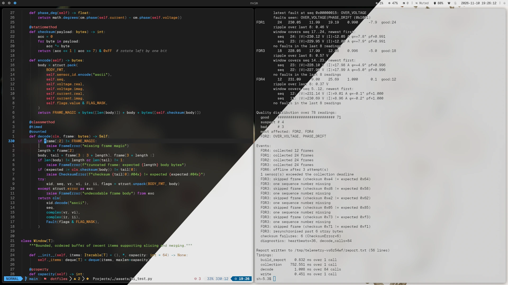
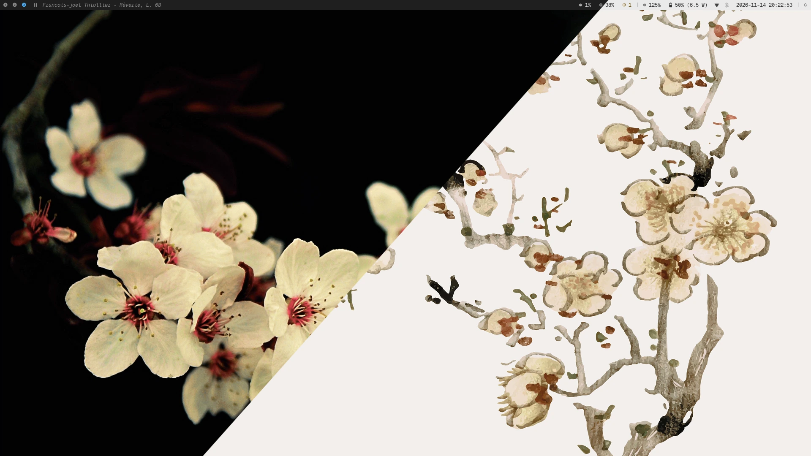

<div align="center">


# dotfiles

</div>

Hi. This is my dotfiles repository, managed with [chezmoi](https://chezmoi.io).

I made this repository to record how I set everything up, so I can look back at
it if I ever need to. I figured there's no reason not to share it in case
someone else finds it useful.

<table>
  <tr>
    <td></td>
    <td></td>
  </tr>
</table>

## Machines

| Profile    | Hardware                            | Session        | Selection rule                                  |
| :--------- | :---------------------------------- | :------------- | :---------------------------------------------- |
| `thinkpad` | ThinkPad L14 Gen 1                  | Sway (Wayland) | Default for any hostname other than `optiplex`  |
| `optiplex` | Dell OptiPlex 5060 (GeForce GT 630) | i3 (X11)       | Selected when the system hostname is `optiplex` |

## Quick bootstrap

See the [Installation guide](https://athaurian.github.io/dotfiles/installation/)
for the required [`forge`](https://github.com/athaurian/forge) package
repository setup before running `chezmoi`:

```bash
chezmoi init https://github.com/athaurian/dotfiles
cd ~/.local/share/chezmoi
make dark   # or: make light
```

## Documentation

For the full set of guides, see the
[documentation index](https://athaurian.github.io/dotfiles).

## License

MIT
