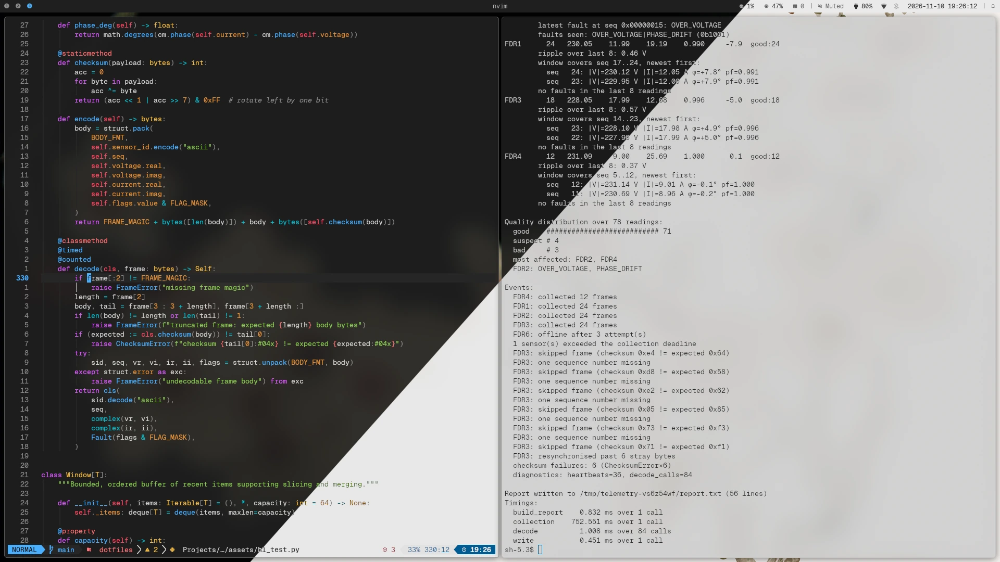
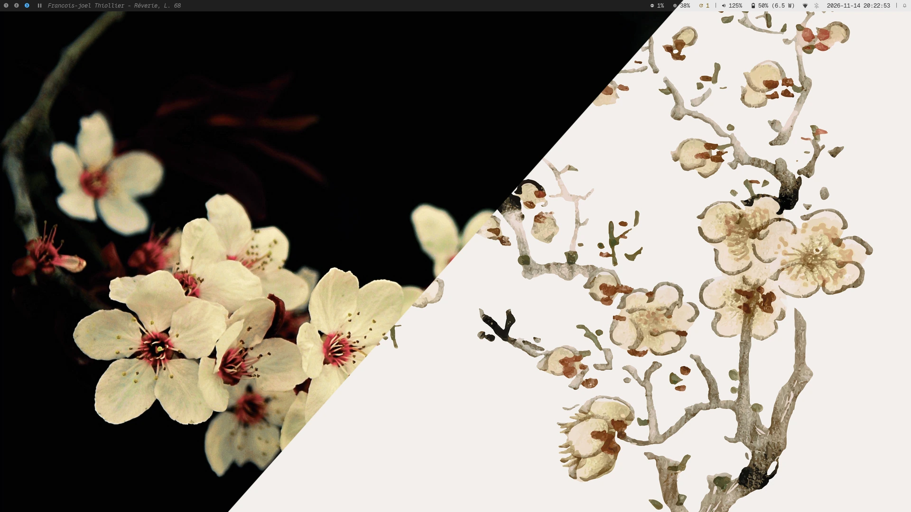

# dotfiles

  <figure>
    
  </figure>
  <figure>
    
  </figure>

Hi. This is the documentation I wrote for my dotfiles repository. If you'd
rather read the source code, it's on
[GitHub](https://github.com/athaurian/dotfiles).

The repository contains my setup for two machines with different hardware.

My `thinkpad` laptop runs Sway on Wayland, and my `optiplex` desktop runs i3 on
X11. Both machines share most keybindings and the full color palette. See
[Machines](machines.md) for the few bindings that only one machine has.

I made both light and dark modes because dark mode is difficult to read
outdoors. I still like using it indoors, though.

As a final note, I made this repository to record how I set up everything for
day-to-day use, so I can look back at it if I ever need to. I figured there's no
reason not to share it, in case someone else finds it useful.

Start with [Installation](installation.md).

## Guides

Each guide covers one part of the setup:

| Guide                                                   | Covers                                                      |
| ------------------------------------------------------- | ----------------------------------------------------------- |
| [Installation](installation.md)                         | Requirements and the first apply                            |
| [Machines](machines.md)                                 | Components on `thinkpad` and `optiplex`                     |
| [Keybindings](keybindings.md)                           | Window management bindings shared by both machines          |
| [Palette system](palette-system.md)                     | Where the desktop colors come from                          |
| [Pickers](pickers.md)                                   | Application launcher, power bindings, and clipboard history |
| [Screenshots, lock, and idle](screenshots-lock-idle.md) | Capture, lock, and idle shortcuts                           |
| [Background services](services.md)                      | Units that start with each session                          |
| [Status bar](statusbar.md)                              | Waybar on `thinkpad` and Polybar on `optiplex`              |
| [Neovim](neovim.md)                                     | LazyVim setup, plugins, and Discord presence                |
| [Themes](theming.md)                                    | Dark mode, light mode, and the wallpapers                   |
