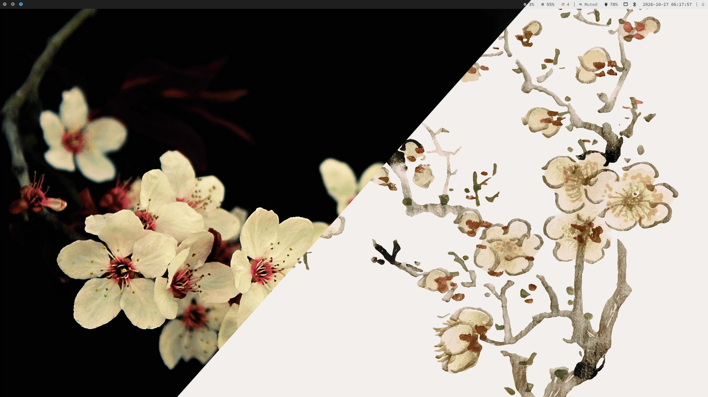

# dotfiles

  <figure>
    
  </figure>
  <figure>
    
  </figure>

## Preface

Hi. This is my dotfiles repository, managed by a neat tool called
[`chezmoi`](https://www.chezmoi.io/). It contains my setup for two machines with
conflicting hardware components. The `thinkpad` laptop runs Sway on Wayland, and
the `optiplex` desktop runs i3 on X11. The two machines share the keybindings
and the color palette.

Thankfully, with `chezmoi`, I can easily separate the two machines in a single
source tree, so I didn't have to make two disjointed Git branches like a psycho.
Once everything is in place, the machine's hostname determines which files
chezmoi copies, which packages it installs, and which setup I get.

I decided to make both light and dark themes because dark mode is awful to use
outdoors. I still like using it indoors, though.

As a final note, this documentation is for people who are setting up or
maintaining the desktop, which is me (duh).

Start with [Installation](installation.md).

## Guides

Each guide covers one part of the desktop:

- [Installation](installation.md) sets up the prerequisites and the first apply.
- [Machines](machines.md) compares the components on `thinkpad` and `optiplex`.
- [Keybindings](keybindings.md) lists the window management bindings shared by
  both machines.
- [Palette system](palette-system.md) explains where every color in the system
  comes from.
- [Pickers](pickers.md) introduces the application launcher and the power
  shortcuts.
- [Screenshots, lock, and idle](screenshots-lock-idle.md) covers the capture,
  lock, and idle shortcuts.
- [Background services](services.md) explains which units start with each
  session.
- [Status bar](statusbar.md) describes Waybar on `thinkpad` and Polybar on
  `optiplex`.
- [Neovim](neovim.md) covers the LazyVim setup, plugins, and Discord presence.
- [Themes](theming.md) explains dark mode, light mode, and the wallpapers.
