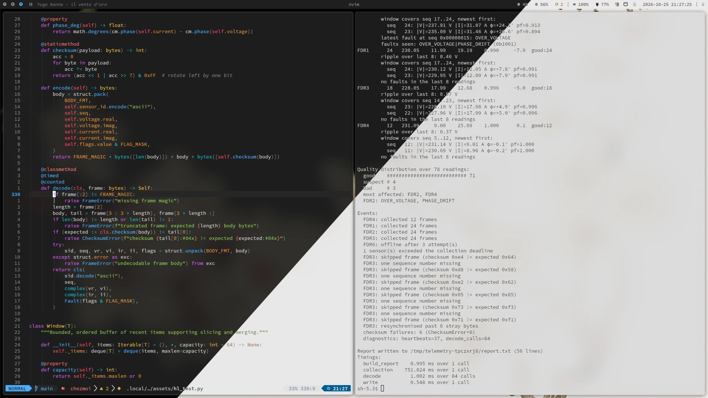

# Neovim

Neovim is my editor. I manage its configuration with chezmoi like the rest of
this repository. If you want, you can read the source code under
[`home/dot_config/nvim/`](https://github.com/athaurian/dotfiles/tree/main/home/dot_config/nvim/).

I like it because its design is intentionally modest. I want an editor that
works exactly the way I expect without turning its maintenance into a day job.

<figure class="screenshot">
  
</figure>

## Why LazyVim

I decided to use LazyVim and build on top of it instead of starting from
scratch, because, well, I'm lazy. It's in the name.

Starting from a clean slate would mean reinventing the wheel from first
principles. The point is that it lets me keep my overrides small. I can spend my
time _actually_ using the editor instead of having to learn Neovim's internals
just to tune it to my liking.

## Looking like the desktop

Neovim is the single most important piece in this setup, so I don't want it to
keep its default appearance.
[The Catppuccin theme](https://github.com/catppuccin/nvim) gives it a solid base
I can edit to match my predefined palette in
[`meta/palette.toml`](https://github.com/athaurian/dotfiles/blob/main/meta/palette.toml).

Switching between light and dark updates the editor along with everything else!

<figure class="screenshot no-radius">
  
  
</figure>

## Discord presence

I had a lot of fun configuring the Cord plugin. I borrowed the layout from the
[VSCord extension](https://github.com/LeonardSSH/vscord). Fortunately, Lua is
powerful enough that I can make an effort to match what it displays on Discord.
Isn't that cool?

It shows `Viewing` until I edit the buffer. Once I start editing the file, it
switches to `Working on file:line:column` and appends the number of errors and
warnings. Also, when the repository I'm working in has a Git remote, it displays
a `View Repository` button that opens the repository in my browser.

<figure class="screenshot no-radius">
  
  
</figure>
