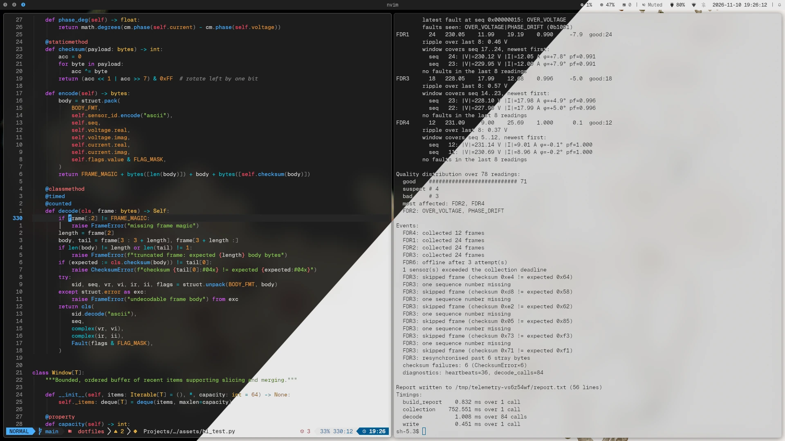

# Neovim

<figure class="screenshot">
  
</figure>

Neovim is my editor. I keep its configuration under
[`home/dot_config/nvim/`](https://github.com/athaurian/dotfiles/tree/main/home/dot_config/nvim/).
I like it because its design is intentionally modest. I want an editor that
works exactly the way I expect without adding regular maintenance work. Most
functionality comes from plugins, which LazyVim supplies and manages.

## LazyVim configuration

A configuration written from scratch would duplicate work that LazyVim already
does. LazyVim lets me keep my overrides small. I can spend more time _actually_
using the editor instead of learning Neovim's internals just to change its
behavior. I confine my overrides to five areas, each in its own file under
`lua/plugins/`:

- the colorscheme,
- Discord presence,
- the dashboard,
- session persistence,
- the Snacks configuration.

## Live palette synchronization

<figure class="screenshot no-radius">
  
  
</figure>

Neovim uses `catppuccin` with color slots overridden from `meta/palette.toml`. A
mode switch reaches running instances in three stages:

1. When you press `$mod+Shift+t` or run `make dark` / `make light`, the flow in
   [Mode switch behavior](system/palette-system.md#mode-switch-behavior) starts.
2. `chezmoi` rewrites `~/.config/nvim/lua/plugins/colorscheme.lua`.
3. The watcher in `lua/config/palette.lua` reloads the colorscheme in every
   running instance. No restart is necessary.

## Discord Rich Presence (`cord.nvim`)

<figure class="screenshot no-radius">
  
  
</figure>

`cord.nvim` publishes the current editor activity to Discord. I suppress
workspace and file details in sensitive repositories by creating an empty
`.cordprivate` file at the project root:

```bash
touch .cordprivate
```

A marker file suppresses presence details for a whole project tree: the plugin
honors `.cordprivate` in any ancestor directory, which means one file at the
project root covers every file below it. When the marker is found, three fields
are replaced with a generic editing message:

- the project name,
- the filename,
- the repository button.

The mechanism affects your Discord Rich Presence metadata only; it does not
alter local editor state.
