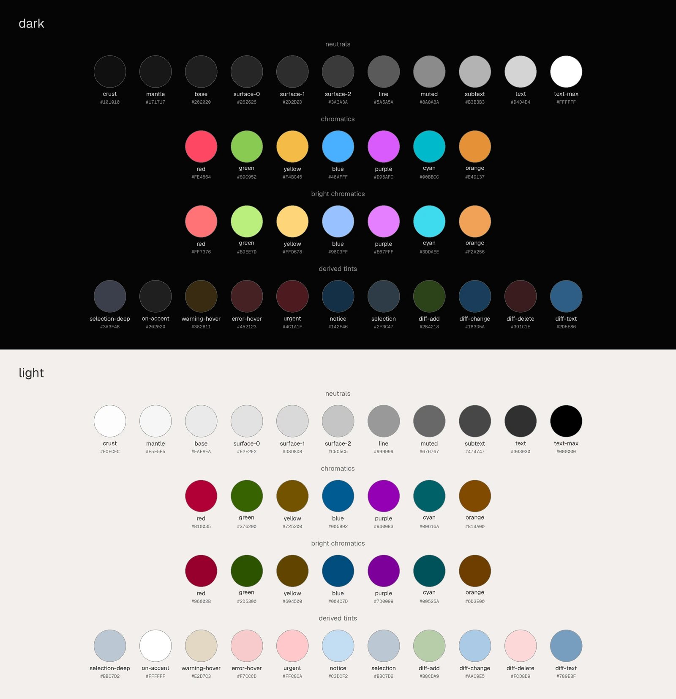

# Palette system

Every color in my setup comes from
[`meta/palette.toml`](https://github.com/athaurian/dotfiles/blob/main/meta/palette.toml).
Change a value there, and it changes across the whole desktop at once.

Most colors carry two values, one for dark mode and one for light mode. The two
utility colors have one value each. The tints derive from another color instead
of being written by hand.

<figure class="screenshot">
  
  <figcaption>Every palette value in both modes.</figcaption>
</figure>

The preceding card is a live capture rather than a rendered diagram. Rebuild it
with `make shots` after changing the palette, because nothing else regenerates
it.

I use the [`Makefile`](https://github.com/athaurian/dotfiles/blob/main/Makefile)
targets to regenerate and apply the palette:

- The `palette` target regenerates the derived palette data without applying
  anything, so follow it with `chezmoi apply`.
- The `dark` and `light` targets regenerate the same data and apply the
  configuration in the chosen mode.

Don't edit the generated files by hand. Regeneration replaces the palette data
that every template reads. The look-up table (LUT) palettes under
[`home/dot_config/lutgen/`](https://github.com/athaurian/dotfiles/tree/main/home/dot_config/lutgen/)
get replaced too. The data file is listed in `.gitignore`, so you'll only find
it after running the generator.
[`meta/lut-palette.md`](https://github.com/athaurian/dotfiles/blob/main/meta/lut-palette.md)
describes how the tables are built.

## Colors outside the palette

A few colors are intentionally defined outside the palette: the shell prompt's
ANSI colors, the black fill behind the blurred lock screen, and the palette
card's panel background.

The documentation site has its own theme too, which uses a warm-paper light
scheme in
[`docs/stylesheets/extra.css`](https://github.com/athaurian/dotfiles/blob/main/docs/stylesheets/extra.css).
