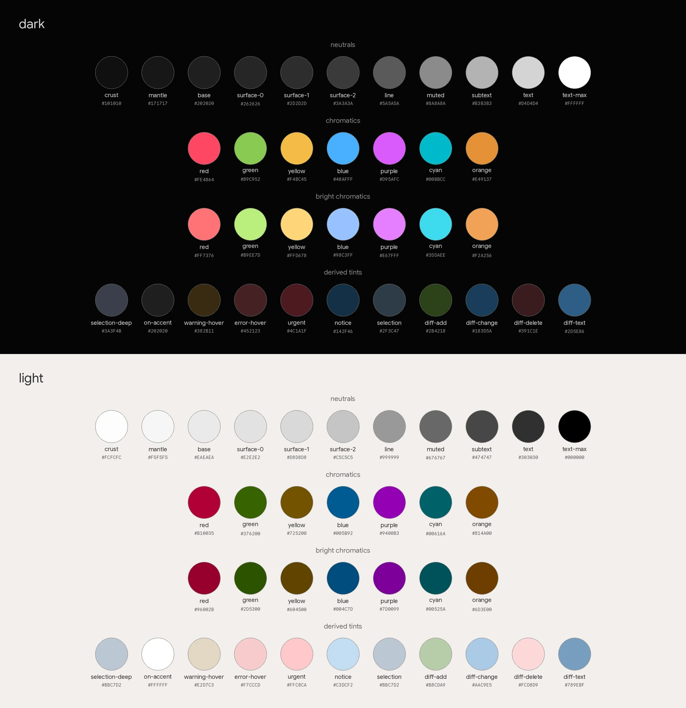

# Palette system

Every color in the system comes from
[`meta/palette.toml`](https://github.com/athaurian/dotfiles/blob/main/meta/palette.toml).

Each color carries two values, one for dark mode and one for light mode, and
flipping the mode swaps every value on the desktop at once.

<figure class="screenshot">
  
  <figcaption>Every palette value in both modes.</figcaption>
</figure>

I use the [`Makefile`](https://github.com/athaurian/dotfiles/blob/main/Makefile)
targets to regenerate and apply the palette:

- The `palette` target regenerates the derived palette data without applying
  anything.
- The `dark` and `light` targets regenerate the same data and apply the
  configuration in the chosen mode.

The derived output includes
[`home/.chezmoidata.yaml`](https://github.com/athaurian/dotfiles/blob/main/home/.chezmoidata.yaml)
and the look-up table (LUT) palettes under
[`home/dot_config/lutgen/`](https://github.com/athaurian/dotfiles/tree/main/home/dot_config/lutgen/).
Don't hand-edit those, since regeneration replaces them. You can look at the
`Makefile` targets and
[`meta/palette.py`](https://github.com/athaurian/dotfiles/blob/main/meta/palette.py)
for the exact recipe.
