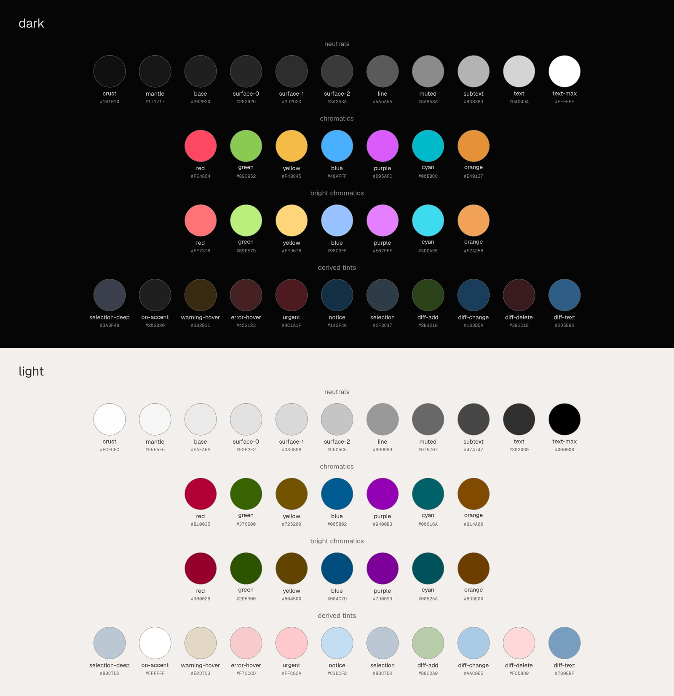

# Palette system

Almost all desktop colors derive from a single source file: `meta/palette.toml`.
It defines semantic tokens (backgrounds, foregrounds, borders, accents, and ANSI
terminal slots) for both `dark` and `light` modes. Downstream consumers receive
those tokens through derived files rather than reading the source directly.

<figure class="screenshot">
  
  <figcaption>Every palette value in both modes.</figcaption>
</figure>

## Generating and applying palettes

Two distinct operations act on the palette. `make shots` combines them. A mode
switch changes the live desktop; regeneration only rewrites files in the
checkout. The distinction matters when diagnosing a stale theme: a regenerated
file has no effect until it is applied.

| Command                               | Mode file written | Files regenerated | Live desktop changed |
| :------------------------------------ | :---------------- | :---------------- | :------------------- |
| `make dark` / `make light`            | Yes               | Yes               | Yes                  |
| `make palette MODE=dark` (or `light`) | No                | Yes               | No                   |
| `make shots`                          | Yes               | Yes               | Yes                  |

The screenshot run switches modes to capture both variants and restores the
original mode on exit. Its net effect on the recorded mode is no change.

Four terms are used with fixed meanings on this and neighboring pages.

| Term          | Meaning                                                                 |
| :------------ | :---------------------------------------------------------------------- |
| Derived files | The outputs of `meta/palette.py` computed from `meta/palette.toml`      |
| Regeneration  | Producing derived files with `make palette`                             |
| Apply         | Installing derived files into `$HOME` with `chezmoi apply`              |
| Mode switch   | Regeneration, apply, and live reload through `make dark` / `make light` |

### Mode switch behavior

Both mode-switch targets execute one flow and differ only in the recorded mode.
Run them from the `chezmoi` checkout. The stages are ordered, and a failure
stops the run at the failing stage:

1. Write the chosen mode to `~/.local/state/palette-mode`.
2. Regenerate the palette data for that mode with `meta/palette.py`.
3. Apply the derived files with `chezmoi apply --force`. The force flag allows
   destination files that differ from the source state to be overwritten.
4. The apply runs the `run_onchange_after_gtk-mode-hook.sh.tmpl` hook. It
   updates the running applications listed below. Neovim uses its own watcher in
   the next stage.
5. The watcher in `lua/config/palette.lua` reloads the colorscheme in every
   running Neovim instance.

The mode file is written first so that the wallpaper rotator reads the new value
during the apply. The remaining stages separate file generation from process
reload: an application holding a palette in memory requires a signal, not a
rewritten configuration file.

| Application               | Update behavior                                             |
| :------------------------ | :---------------------------------------------------------- |
| GTK applications          | GSettings keys for theme, icons, and fonts                  |
| Calibre                   | Its UI palette config, only while the application is closed |
| Wallpaper                 | Recolored through `sw --restore`                            |
| Sway, i3, Waybar, Polybar | Reload their updated configuration files                    |
| `kitty`                   | Repaints open windows on `SIGUSR1`                          |
| `dunst`                   | Reloads its configuration                                   |
| `picom` (X11)             | Restarts with the updated configuration                     |

Calibre is guarded because it rewrites its own configuration on exit. An edit
made while a window is open would be lost.

### Regeneration without application

Regeneration changes only the checkout. It touches neither the live session nor
the recorded mode. Consequently, a regenerated file has no visible effect until
it is applied. The scope is given in the comparison table above. The cases in
which this is the right choice are:

- after editing `meta/palette.toml`, to inspect the generated output;
- before committing a change that affects generated output.

### Generated files

The generator writes the following files. None of them should be edited by hand.

| Path                                              | Contents                                      | Tracked | Used by                                                                    |
| :------------------------------------------------ | :-------------------------------------------- | :------ | :------------------------------------------------------------------------- |
| `home/.chezmoidata.yaml`                          | The chezmoi template data for the active mode | No      | Every palette-aware template, which reads its tokens from this file        |
| `home/dot_config/lutgen/neutral`, `neutral-light` | `lutgen` palette lists for both modes         | Yes     | [`sw`](../desktop/wallpapers.md), which passes the active list to `lutgen` |

The active list is converted into a [Hald CLUT](../glossary.md#hald-clut) by
[`lutgen`](../glossary.md#lutgen), and the result is cached under the utility's
cache directory. Rendered wallpapers occupy a separate cache. Both paths are
listed under [Wallpapers](../desktop/wallpapers.md).

`meta/palette.toml` is the only supported edit point. After changing it,
regenerate the derived files at the required scope:

- Files only: `make palette`.
- Files and live session: a mode switch, following the flow above.

## Intentional exceptions outside `meta/palette.toml`

Four places use fixed colors rather than changing with the palette:

1. **Shell prompt (`PS1`)**: Uses standard terminal ANSI color slots (`1–7`),
   which adapt when the terminal reloads its palette.
2. **Lock screen fallback fill**: Uses pure black (`#000000`) behind the lock
   image so monitors with different aspect ratios do not glow around the edges
   in a dark room.
3. **Palette preview card background**: Uses a fixed neutral backdrop so dark
   and light swatches can be compared side by side without optical contrast
   shifts.
4. **Documentation site theme**: Managed separately through
   [`docs-theme`](https://github.com/athaurian/docs-theme) so the web docs
   remain readable independent of desktop tweaks.
